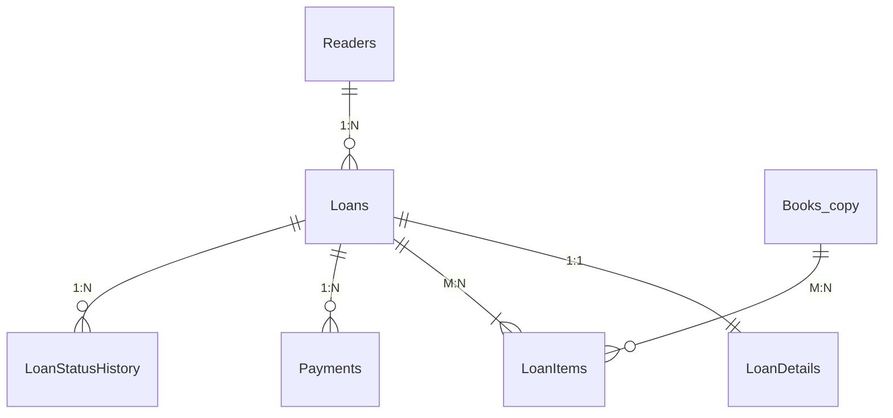
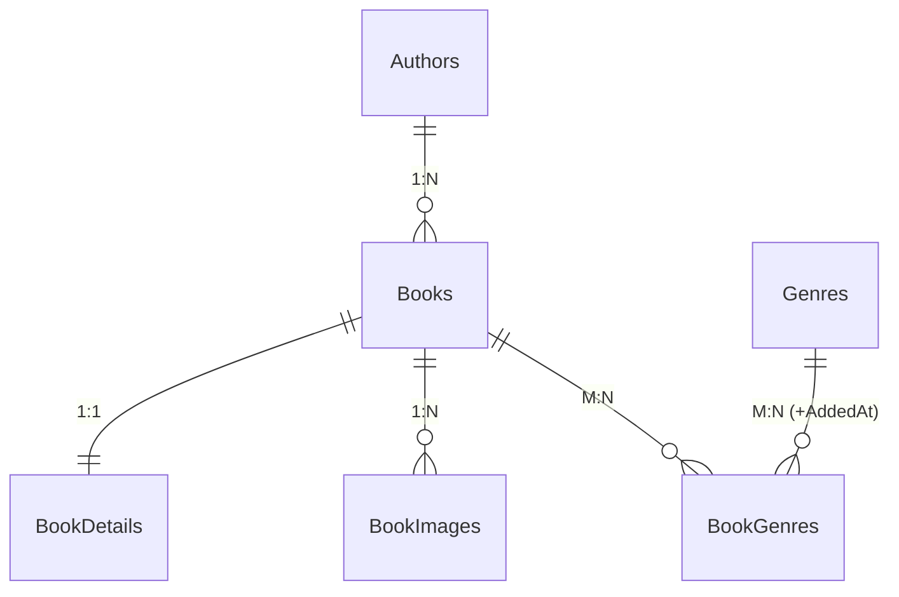

# Онлайн-бібліотека — мікросервісна платформа на .NET

Навчальний проєкт курсу «Розробка додатків на платформі .NET / Технології .NET розробки web-додатків».
Кожна лабораторна робота виконана в окремій гілці (`lab-01` … `lab-10`), кожна наступна продовжує попередню.

## Предметна область

**Онлайн-бібліотека.** Читачі переглядають каталог книг, оформлюють **видачу** (оренду) примірників
із самовивозом чи доставкою, оплачують плату за видачу й повертають книги; бібліотекарі ведуть каталог
і обробляють видачі. Читачі також залишають **відгуки** з оцінками та обговорюють книги в читацьких клубах.

## Три незалежні контексти (Bounded Contexts) — кожен зі своєю БД

| Проєкт | Контекст / сервіс | База | Технологія | Сутності (належать лише цьому контексту) |
|---|---|---|---|---|
| №1 | **Loans** — видачі | `LoansDb` | SQL Server + ADO.NET & Dapper | `Readers`, `Loans`, `LoanDetails`, `LoanItems`, `LoanStatusHistory`, `Payments`, `Books` (локальна копія довідника) |
| №2 | **Books** — каталог книг | `BooksDb` | SQL Server + EF Core (Code First) | `Books`, `BookDetails`, `BookImages`, `Authors`, `Genres`, `BookGenres` |
| №3 | **Feedback** — відгуки й обговорення | `FeedbackDb` | MongoDB | `reviews` (вбудовані `comments`, `author`), `discussions`, `messages`, `bookRatings` |

Агрегати: **Loan** (Loans + LoanDetails + LoanItems + LoanStatusHistory — позиції не існують без видачі),
**Book** (Book + BookDetail + BookImages + BookGenres), **Review** (документ із вбудованими коментарями),
**Discussion** (заголовок + 3 останні повідомлення; усі повідомлення — окрема колекція).
Детально: [docs/domain.md](docs/domain.md).

### Три самостійні бази без FOREIGN KEY між ними

* Кожна база розгортається окремо, не має спільних таблиць і не посилається на інші бази.
* Посилання на чужу сутність — **лише ідентифікатор**: `LoansDb.dbo.Books.Id` і `LoanItems.BookId` — це
  Id книги з `BooksDb`, але без `FOREIGN KEY` на іншу базу (FK `LoanItems → Books` веде на **локальну**
  таблицю-копію всередині `LoansDb`); `reviews.bookId` у MongoDB — так само логічне посилання.
* Перевірка: `SELECT * FROM sys.foreign_keys` у `LoansDb` і `BooksDb` показує лише зв'язки всередині своєї бази
  (див. `db/p1/checks.sql`, `db/p2/checks.sql`).

## Таблиця політики дублювання даних

| Поле | Де зберігається | Джерело (власник даних) | Політика узгодженості |
|---|---|---|---|
| `LoanItems.BookTitle`, `LoanItems.UnitPrice` | LoansDb | `Book` (BooksDb, Каталог) | **знімок** на момент оформлення — не оновлюється |
| `Books.Title`, `Books.Isbn`, `Books.Price` (локальна копія довідника) | LoansDb | `Book` (BooksDb, Каталог) | оновлюється **подіями** з Каталогу (`BookPriceChanged`, `BookRenamed`) |
| `reviews.bookTitle` | FeedbackDb (MongoDB) | `Book` (BooksDb, Каталог) | оновлюється **подіями** з Каталогу (`BookRenamed`) |
| `discussions.bookTitle`, `bookRatings.bookTitle` | FeedbackDb (MongoDB) | `Book` (BooksDb, Каталог) | оновлюється **подіями** з Каталогу (`BookRenamed`) |
| `reviews.author.displayName`, `comments[].author.displayName` | FeedbackDb | профіль користувача (Identity) | **знімок** підпису на момент написання — не оновлюється |
| `discussions.lastMessages[]` | FeedbackDb | колекція `messages` (той самий контекст) | оновлюється в тій самій операції, що додає повідомлення (subset pattern) |
| `bookRatings.average / ratingsCount / distribution` | FeedbackDb | колекція `reviews` (той самий контекст) | обчислюється агрегацією `$merge` після зміни відгуків |

`Books.AvailableCopies` у LoansDb **не дублюється**: це власні дані «Видач» (примірники на полиці);
Каталог зберігає інший факт — `TotalCopies` (розмір фонду). Пари сервісів: Books→Loans і Books→Feedback
мають рядки вище; Loans↔Feedback не обмінюються даними. Повна версія: [docs/duplication-policy.md](docs/duplication-policy.md).

## ERD

* Проєкт №1 `LoansDb` — [docs/erd-p1.md](docs/erd-p1.md) (Mermaid ERD, ключі, індекси, процедури) · [DBML для dbdiagram.io](docs/erd-p1.dbml)
* Проєкт №2 `BooksDb` — [docs/erd-p2.md](docs/erd-p2.md) · [DBML](docs/erd-p2.dbml)
* Проєкт №3 `FeedbackDb` — [docs/mongo-p3.md](docs/mongo-p3.md) (колекції, приклади документів, індекси, агрегації)





## Структура репозиторію

```text
README.md                 опис домену, запуск, розгортання БД, таблиця дублювання
Library.sln               єдине рішення для всіх сервісів
docs/                     ERD-діаграми, опис контекстів, приклади документів MongoDB
Services/
  Loans/                  Лаб. 02 — сервіс видач (ADO.NET + Dapper, тришарова архітектура)
    Loans.Api · Loans.Bll · Loans.Dal · Loans.Domain · Loans.Tests · Loans.AppHost
db/
  deploy.ps1 / deploy.sh  розгортання всіх трьох баз з нуля однією командою
  security.sql            окремі логіни застосунків з доступом лише до своєї БД
  p1/  schema.sql · procedures.sql · seed.sql · checks.sql        (LoansDb, SQL Server)
  p2/  schema.sql · seed.sql · checks.sql                         (BooksDb, SQL Server)
  p3/  collections.js · seed.js · queries.js · checks.js          (FeedbackDb, MongoDB)
```

## Розгортання баз даних з нуля

Потрібно: **Docker Desktop** (або локальні SQL Server 2019+ і MongoDB 6+ з `sqlcmd` і `mongosh`).

**1. Запустити SQL Server і MongoDB у контейнерах**

```bash
docker run -d --name library-sql -e ACCEPT_EULA=Y -e MSSQL_SA_PASSWORD=Library_Pass123 -p 1433:1433 mcr.microsoft.com/mssql/server:2022-latest
docker run -d --name library-mongo -p 27017:27017 mongo:7
```

**2. Розгорнути всі бази однією командою** (скрипти ідемпотентні — повторний запуск нічого не дублює)

```powershell
# Windows (PowerShell)
.\db\deploy.ps1
```
```bash
# Linux / macOS / Git Bash
SQL_CONTAINER=library-sql MONGO_CONTAINER=library-mongo SA_PASSWORD=Library_Pass123 ./db/deploy.sh
```

Порядок, який виконує скрипт (його можна повторити вручну в SSMS / Azure Data Studio / mongosh):

| Крок | Скрипт | Що робить |
|---|---|---|
| 1 | `db/p1/schema.sql` | створює `LoansDb`: таблиці, ключі, обмеження, TVP-тип, індекси, представлення |
| 2 | `db/p1/procedures.sql` | 6 збережуваних процедур |
| 3 | `db/p1/seed.sql` | читачі, локальна копія книг, 6 видач у різних статусах, історія, платежі |
| 4 | `db/p2/schema.sql` | створює `BooksDb`: 6 таблиць, ключі, обмеження, індекси |
| 5 | `db/p2/seed.sql` | довідник жанрів, автори, книги, деталі, зображення, зв'язки книга–жанр |
| 6 | `db/security.sql` | логіни `loans_app` → лише `LoansDb`, `books_app` → лише `BooksDb` (найменші привілеї) |
| 7 | `db/p3/collections.js` | створює `FeedbackDb`: 4 колекції з JSON Schema Validation та індексами |
| 8 | `db/p3/seed.js` | відгуки, обговорення, повідомлення; перерахунок `bookRatings` агрегацією |

**3. Перевірити**

```bash
docker exec -i library-sql /opt/mssql-tools18/bin/sqlcmd -C -S localhost -U sa -P Library_Pass123 -I -i /tmp/library-db/p1/checks.sql
docker exec -i library-sql /opt/mssql-tools18/bin/sqlcmd -C -S localhost -U sa -P Library_Pass123 -I -i /tmp/library-db/p2/checks.sql
docker exec -i library-mongo mongosh --quiet --file /tmp/library-db/p3/checks.js
docker exec -i library-mongo mongosh --quiet --file /tmp/library-db/p3/queries.js
```

`checks.sql` для `LoansDb` демонструє CRUD через процедури, пошук і пагінацію, знімок ціни, відмову
`usp_UpdateLoanDetails` на застарілому `RowVersion` (`50003`), **відмову `usp_ChangeLoanStatus` видати неоплачену
видачу керованою помилкою `50002`**, повний допустимий ланцюжок статусів та ідемпотентність оплати.
`checks.js` показує документи різної структури в `reviews`, роботу валідатора (rating = 10 → помилка 121),
унікального індексу (E11000), `$lookup` і повнотекстовий пошук.

Ручна перевірка процедури зміни статусу:

```sql
USE LoansDb;
DECLARE @id BIGINT = (SELECT Id FROM dbo.Loans WHERE Number = N'LN-SEED-002');   -- статус Reserved (не оплачено)
EXEC dbo.usp_ChangeLoanStatus @LoanId = @id, @NewStatus = N'Issued';
-- Msg 50002: Transition Reserved -> Issued is not allowed
```

## Ключові рішення Лаб. 01

* **PK:** `BIGINT IDENTITY` у `LoansDb` (вставка з одного джерела, компактний послідовний ключ), `INT IDENTITY`
  у `BooksDb`; `LoansDb.Books.Id` — без `IDENTITY` (Id Каталогу). GUID обрали б, якби Id генерувались у різних місцях.
* **Обмеження:** PK / FK / UNIQUE / CHECK / DEFAULT у кожній SQL-базі; каскад — лише для залежних частин агрегату.
* **Індекси:** кожен описано в DDL коментарем із запитом, під який він створений (фільтровані, покриваючі, унікальні).
* **Аудит і конкурентність:** `CreatedAt/By`, `UpdatedAt/By`, `IsDeleted`, `RowVersion` у `Readers`, `Loans`, `Books`.
* **Процедури (LoansDb):** `usp_CreateLoan`, `usp_GetLoanById`, `usp_UpdateLoanDetails`, `usp_ChangeLoanStatus`
  (транзакційна зміна статусу з перевіркою переходу), `usp_ConfirmLoan`, `usp_RegisterPayment`.
* **MongoDB:** embedding (`author`, `comments`), referencing (`discussionId`, `messages.discussionId`),
  гібрид (`discussions.lastMessages` + `messages`; `bookRatings.topReviewIds`), гнучка схема, денормалізоване `bookTitle`.

## Лаб. 02 — сервіс Loans: тришарова архітектура на ADO.NET та Dapper

Детальний опис, таблиця ендпоінтів і приклади запитів: [Services/Loans/README.md](Services/Loans/README.md).

**Що потрібно:** .NET 8 SDK, Docker Desktop.

**Запуск однією командою через .NET Aspire** (SQL Server у контейнері + API):

```bash
dotnet run --project Services/Loans/Loans.AppHost
```

У Aspire Dashboard ресурси `sql` і `loans-api` мають статус Running; Swagger — `http://localhost:5101/swagger`.

**Схема рішення:** `Loans.Api` (контролери, ProblemDetails, Swagger, Serilog) → `Loans.Bll` (сервіси, DTO, AutoMapper)
→ `Loans.Dal` (Generic Repository, 1 репозиторій на чистому ADO.NET — `ReaderRepository`, 2 на Dapper — `LoanRepository`,
`BookRepository`, Unit of Work) → `LoansDb`; `Loans.Domain` — моделі й доменні винятки для DAL і BLL.

| Сценарій | Запит | Результат |
|---|---|---|
| Створення | `POST /api/loans` | 201 + `Location` |
| Транзакція з двох репозиторіїв | `POST /api/loans/{id}/confirm` | 204; при нестачі примірників — 409 і відкат статусу |
| Повторне підтвердження | `POST /api/loans/{id}/confirm` | 409 ProblemDetails (THROW 50002 з процедури) |
| Видача неоплаченої | `POST /api/loans/{id}/issue` | 409 ProblemDetails |
| Неіснуючий Id | `GET /api/loans/999999` | 404 ProblemDetails (не 500) |
| Некоректні дані | `POST /api/loans` з `readerId: 0` | 400 ValidationProblemDetails |
| Ім'я з апострофом | `POST /api/readers` з `O'Brien` | 201 — параметризація без SQL-помилок |

```bash
curl -i http://localhost:5101/api/loans/999999
curl -X POST http://localhost:5101/api/loans -H "Content-Type: application/json" -d "{\"readerId\":1,\"items\":[{\"bookId\":1,\"quantity\":1}]}"
curl -i -X POST http://localhost:5101/api/loans/7/confirm
```

**Git:** кожна лабораторна — окрема гілка `lab-XX` від попередньої (feature-гілка), `main` — стабільна;
зміни зливаються в `main` через Pull Request після захисту.
