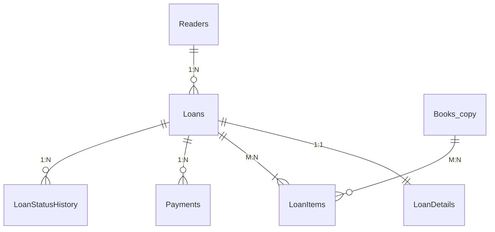
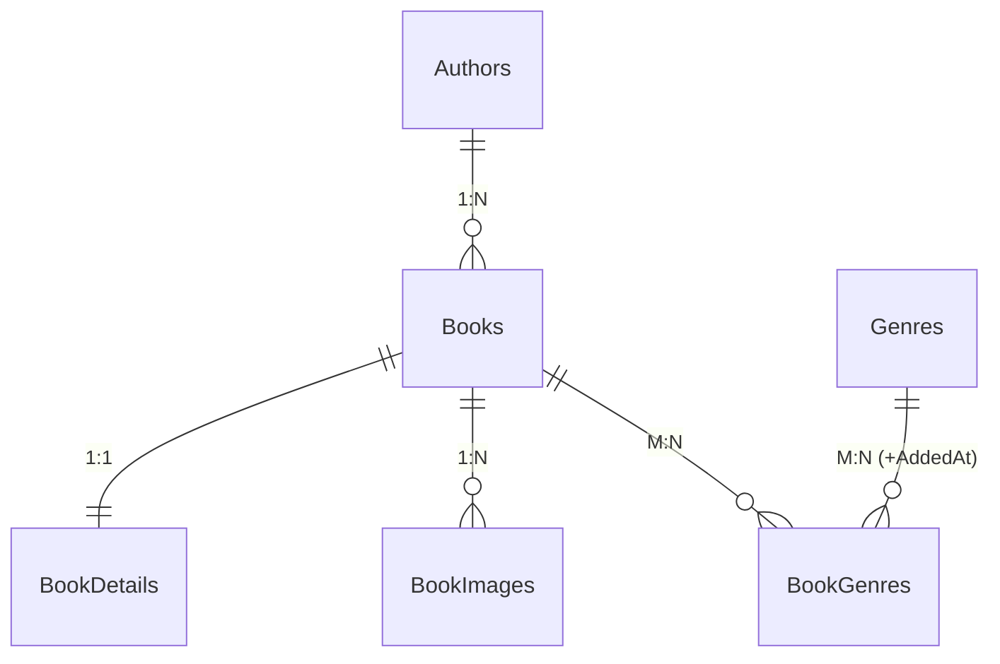

# Онлайн-бібліотека — мікросервісна платформа на .NET

Навчальний проєкт курсу «Розробка додатків на платформі .NET / Технології .NET розробки web-додатків».
Кожна лабораторна робота виконана в окремій гілці (`lab-01` … `lab-10`), кожна наступна продовжує попередню.

## Предметна область

**Онлайн-бібліотека.** Читачі переглядають каталог книг, оформлюють **видачу** (оренду) примірників
із самовивозом чи доставкою, оплачують плату за видачу й повертають книги; бібліотекарі ведуть каталог
і обробляють видачі. Читачі також залишають **відгуки** з оцінками та обговорюють книги в читацьких клубах.

## Три незалежні контексти (Bounded Contexts) — кожен зі своєю БД

| Проєкт | Контекст / сервіс | База | Технологія | Сутності (належать лише цьому контексту) |
|---|---|---|---|---|
| №1 | **Loans** — видачі | `LoansDb` | SQL Server + ADO.NET & Dapper | `Readers`, `Loans`, `LoanDetails`, `LoanItems`, `LoanStatusHistory`, `Payments`, `Books` (локальна копія довідника) |
| №2 | **Books** — каталог книг | `BooksDb` | SQL Server + EF Core (Code First) | `Books`, `BookDetails`, `BookImages`, `Authors`, `Genres`, `BookGenres` |
| №3 | **Feedback** — відгуки й обговорення | `FeedbackDb` | MongoDB | `reviews` (вбудовані `comments`, `author`), `discussions`, `messages`, `bookRatings` |

Агрегати: **Loan** (Loans + LoanDetails + LoanItems + LoanStatusHistory — позиції не існують без видачі),
**Book** (Book + BookDetail + BookImages + BookGenres), **Review** (документ із вбудованими коментарями),
**Discussion** (заголовок + 3 останні повідомлення; усі повідомлення — окрема колекція).
Детально: [docs/domain.md](docs/domain.md).

### Три самостійні бази без FOREIGN KEY між ними

* Кожна база розгортається окремо, не має спільних таблиць і не посилається на інші бази.
* Посилання на чужу сутність — **лише ідентифікатор**: `LoansDb.dbo.Books.Id` і `LoanItems.BookId` — це
  Id книги з `BooksDb`, але без `FOREIGN KEY` на іншу базу (FK `LoanItems → Books` веде на **локальну**
  таблицю-копію всередині `LoansDb`); `reviews.bookId` у MongoDB — так само логічне посилання.
* Перевірка: `SELECT * FROM sys.foreign_keys` у `LoansDb` і `BooksDb` показує лише зв'язки всередині своєї бази
  (див. `db/p1/checks.sql`, `db/p2/checks.sql`).

## Таблиця політики дублювання даних

| Поле | Де зберігається | Джерело (власник даних) | Політика узгодженості |
|---|---|---|---|
| `LoanItems.BookTitle`, `LoanItems.UnitPrice` | LoansDb | `Book` (BooksDb, Каталог) | **знімок** на момент оформлення — не оновлюється |
| `Books.Title`, `Books.Isbn`, `Books.Price` (локальна копія довідника) | LoansDb | `Book` (BooksDb, Каталог) | оновлюється **подіями** з Каталогу (`BookPriceChanged`, `BookRenamed`) |
| `reviews.bookTitle` | FeedbackDb (MongoDB) | `Book` (BooksDb, Каталог) | оновлюється **подіями** з Каталогу (`BookRenamed`) |
| `discussions.bookTitle`, `bookRatings.bookTitle` | FeedbackDb (MongoDB) | `Book` (BooksDb, Каталог) | оновлюється **подіями** з Каталогу (`BookRenamed`) |
| `reviews.author.displayName`, `comments[].author.displayName` | FeedbackDb | профіль користувача (Identity) | **знімок** підпису на момент написання — не оновлюється |
| `discussions.lastMessages[]` | FeedbackDb | колекція `messages` (той самий контекст) | оновлюється в тій самій операції, що додає повідомлення (subset pattern) |
| `bookRatings.average / ratingsCount / distribution` | FeedbackDb | колекція `reviews` (той самий контекст) | обчислюється агрегацією `$merge` після зміни відгуків |

`Books.AvailableCopies` у LoansDb **не дублюється**: це власні дані «Видач» (примірники на полиці);
Каталог зберігає інший факт — `TotalCopies` (розмір фонду). Пари сервісів: Books→Loans і Books→Feedback
мають рядки вище; Loans↔Feedback не обмінюються даними. Повна версія: [docs/duplication-policy.md](docs/duplication-policy.md).

## ERD

* Проєкт №1 `LoansDb` — [docs/erd-p1.md](docs/erd-p1.md) (Mermaid ERD, ключі, індекси, процедури) · [DBML для dbdiagram.io](docs/erd-p1.dbml)
* Проєкт №2 `BooksDb` — [docs/erd-p2.md](docs/erd-p2.md) · [DBML](docs/erd-p2.dbml)
* Проєкт №3 `FeedbackDb` — [docs/mongo-p3.md](docs/mongo-p3.md) (колекції, приклади документів, індекси, агрегації)





## Структура репозиторію

```text
README.md                 опис домену, запуск, розгортання БД, таблиця дублювання
Platform.slnx             одне рішення на всю платформу (формат .slnx)
Platform.AppHost/         оркестрація .NET Aspire (AppHost.cs)
Platform.ServiceDefaults/ Лаб. 05 — спільні Serilog, OpenTelemetry, health checks, resilience, CorrelationId
Platform.ApiGateway/      Лаб. 05 — API Gateway (YARP), єдина точка входу :5000
Platform.Aggregator/      Лаб. 05 — агрегатор «повна картка видачі»
docs/                     ERD-діаграми, опис контекстів, приклади документів MongoDB
Services/
  Loans/                  Лаб. 02 — сервіс видач (ADO.NET + Dapper, тришарова архітектура)
    Loans.Api · Loans.Bll · Loans.Dal · Loans.Domain · Loans.Tests
  Books/                  Лаб. 03 — каталог книг (EF Core Code First, специфікації)
    Books.Api · Books.Bll · Books.Dal (Configurations/, Migrations/, Seeding/) · Books.Domain · Books.Tests
  Feedback/               Лаб. 04 — відгуки й обговорення (Clean Architecture, CQRS/MediatR, MongoDB)
    Feedback.Domain · Feedback.Application · Feedback.Infrastructure · Feedback.WebApi · Feedback.Tests
db/
  deploy.ps1 / deploy.sh  розгортання всіх трьох баз з нуля однією командою
  security.sql            окремі логіни застосунків з доступом лише до своєї БД
  p1/  schema.sql · procedures.sql · seed.sql · checks.sql        (LoansDb, SQL Server)
  p2/  schema.sql · seed.sql · checks.sql                         (BooksDb, SQL Server)
  p3/  collections.js · seed.js · queries.js · checks.js          (FeedbackDb, MongoDB)
```

## Розгортання баз даних з нуля

Потрібно: **Docker Desktop** (або локальні SQL Server 2019+ і MongoDB 6+ з `sqlcmd` і `mongosh`).

**1. Запустити SQL Server і MongoDB у контейнерах**

```bash
docker run -d --name library-sql -e ACCEPT_EULA=Y -e MSSQL_SA_PASSWORD=Library_Pass123 -p 1433:1433 mcr.microsoft.com/mssql/server:2022-latest
docker run -d --name library-mongo -p 27017:27017 mongo:7
```

**2. Розгорнути всі бази однією командою** (скрипти ідемпотентні — повторний запуск нічого не дублює)

```powershell
# Windows (PowerShell)
.\db\deploy.ps1
```
```bash
# Linux / macOS / Git Bash
SQL_CONTAINER=library-sql MONGO_CONTAINER=library-mongo SA_PASSWORD=Library_Pass123 ./db/deploy.sh
```

Порядок, який виконує скрипт (його можна повторити вручну в SSMS / Azure Data Studio / mongosh):

| Крок | Скрипт | Що робить |
|---|---|---|
| 1 | `db/p1/schema.sql` | створює `LoansDb`: таблиці, ключі, обмеження, TVP-тип, індекси, представлення |
| 2 | `db/p1/procedures.sql` | 6 збережуваних процедур |
| 3 | `db/p1/seed.sql` | читачі, локальна копія книг, 6 видач у різних статусах, історія, платежі |
| 4 | `db/p2/schema.sql` | створює `BooksDb`: 6 таблиць, ключі, обмеження, індекси |
| 5 | `db/p2/seed.sql` | довідник жанрів, автори, книги, деталі, зображення, зв'язки книга–жанр |
| 6 | `db/security.sql` | логіни `loans_app` → лише `LoansDb`, `books_app` → лише `BooksDb` (найменші привілеї) |
| 7 | `db/p3/collections.js` | створює `FeedbackDb`: 4 колекції з JSON Schema Validation та індексами |
| 8 | `db/p3/seed.js` | відгуки, обговорення, повідомлення; перерахунок `bookRatings` агрегацією |

**3. Перевірити**

```bash
docker exec -i library-sql /opt/mssql-tools18/bin/sqlcmd -C -S localhost -U sa -P Library_Pass123 -I -i /tmp/library-db/p1/checks.sql
docker exec -i library-sql /opt/mssql-tools18/bin/sqlcmd -C -S localhost -U sa -P Library_Pass123 -I -i /tmp/library-db/p2/checks.sql
docker exec -i library-mongo mongosh --quiet --file /tmp/library-db/p3/checks.js
docker exec -i library-mongo mongosh --quiet --file /tmp/library-db/p3/queries.js
```

`checks.sql` для `LoansDb` демонструє CRUD через процедури, пошук і пагінацію, знімок ціни, відмову
`usp_UpdateLoanDetails` на застарілому `RowVersion` (`50003`), **відмову `usp_ChangeLoanStatus` видати неоплачену
видачу керованою помилкою `50002`**, повний допустимий ланцюжок статусів та ідемпотентність оплати.
`checks.js` показує документи різної структури в `reviews`, роботу валідатора (rating = 10 → помилка 121),
унікального індексу (E11000), `$lookup` і повнотекстовий пошук.

Ручна перевірка процедури зміни статусу:

```sql
USE LoansDb;
DECLARE @id BIGINT = (SELECT Id FROM dbo.Loans WHERE Number = N'LN-SEED-002');   -- статус Reserved (не оплачено)
EXEC dbo.usp_ChangeLoanStatus @LoanId = @id, @NewStatus = N'Issued';
-- Msg 50002: Transition Reserved -> Issued is not allowed
```

## Ключові рішення Лаб. 01

* **PK:** `BIGINT IDENTITY` у `LoansDb` (вставка з одного джерела, компактний послідовний ключ), `INT IDENTITY`
  у `BooksDb`; `LoansDb.Books.Id` — без `IDENTITY` (Id Каталогу). GUID обрали б, якби Id генерувались у різних місцях.
* **Обмеження:** PK / FK / UNIQUE / CHECK / DEFAULT у кожній SQL-базі; каскад — лише для залежних частин агрегату.
* **Індекси:** кожен описано в DDL коментарем із запитом, під який він створений (фільтровані, покриваючі, унікальні).
* **Аудит і конкурентність:** `CreatedAt/By`, `UpdatedAt/By`, `IsDeleted`, `RowVersion` у `Readers`, `Loans`, `Books`.
* **Процедури (LoansDb):** `usp_CreateLoan`, `usp_GetLoanById`, `usp_UpdateLoanDetails`, `usp_ChangeLoanStatus`
  (транзакційна зміна статусу з перевіркою переходу), `usp_ConfirmLoan`, `usp_RegisterPayment`.
* **MongoDB:** embedding (`author`, `comments`), referencing (`discussionId`, `messages.discussionId`),
  гібрид (`discussions.lastMessages` + `messages`; `bookRatings.topReviewIds`), гнучка схема, денормалізоване `bookTitle`.

## Лаб. 02 — сервіс Loans: тришарова архітектура на ADO.NET та Dapper

Детальний опис, таблиця ендпоінтів і приклади запитів: [Services/Loans/README.md](Services/Loans/README.md).

**Що потрібно:** Docker Desktop; .NET SDK **9.0.200+ або 10** (потрібен для рішення формату `Platform.slnx`)
і **.NET 8 SDK/Runtime** (проєкти націлені на `net8.0`). IDE: Visual Studio 2022 17.13+, Rider 2024.3+ або VS Code з C# Dev Kit.

**Запуск однією командою через .NET Aspire** (SQL Server у контейнері + API):

```bash
dotnet run --project Platform.AppHost
```

У Aspire Dashboard ресурси `sql` і `loans-api` мають статус Running; Swagger — `http://localhost:5101/swagger`.

**Схема рішення:** `Loans.Api` (контролери, ProblemDetails, Swagger, Serilog) → `Loans.Bll` (сервіси, DTO, AutoMapper)
→ `Loans.Dal` (Generic Repository, 1 репозиторій на чистому ADO.NET — `ReaderRepository`, 2 на Dapper — `LoanRepository`,
`BookRepository`, Unit of Work) → `LoansDb`; `Loans.Domain` — моделі й доменні винятки для DAL і BLL.
`Platform.AppHost/AppHost.cs` — SQL Server у контейнері (ресурс бази `LoansDb` = ім'я рядка підключення API) + `loans-api` з `WithReference`.

| Сценарій | Запит | Результат |
|---|---|---|
| Створення | `POST /api/loans` | 201 + `Location` |
| Транзакція з двох репозиторіїв | `POST /api/loans/{id}/confirm` | 204; при нестачі примірників — 409 і відкат статусу |
| Повторне підтвердження | `POST /api/loans/{id}/confirm` | 409 ProblemDetails (THROW 50002 з процедури) |
| Видача неоплаченої | `POST /api/loans/{id}/issue` | 409 ProblemDetails |
| Неіснуючий Id | `GET /api/loans/999999` | 404 ProblemDetails (не 500) |
| Некоректні дані | `POST /api/loans` з `readerId: 0` | 400 ValidationProblemDetails |
| Ім'я з апострофом | `POST /api/readers` з `O'Brien` | 201 — параметризація без SQL-помилок |

```bash
curl -i http://localhost:5101/api/loans/999999
curl -X POST http://localhost:5101/api/loans -H "Content-Type: application/json" -d "{\"readerId\":1,\"items\":[{\"bookId\":1,\"quantity\":1}]}"
curl -i -X POST http://localhost:5101/api/loans/7/confirm
```

**Git:** кожна лабораторна — окрема гілка `lab-XX` від попередньої (feature-гілка), `main` — стабільна;
зміни зливаються в `main` через Pull Request після захисту.

## Лаб. 03 — сервіс Books: тришарова архітектура на EF Core

Детально: [Services/Books/README.md](Services/Books/README.md).

```bash
dotnet run --project Services/Books/Books.Api          # застосовує міграції, сідить дані; Swagger: http://localhost:5102/swagger
dotnet ef database update --project Services/Books/Books.Dal --startup-project Services/Books/Books.Api   # або вручну
```

* Code First + Fluent API (`Books.Dal/Configurations`), міграція `InitialCreate` + SQL-скрипт (`Books.Dal/Migrations`).
* Async Generic Repository + 3 специфічні: eager (`BookRepository`), explicit (`GenreRepository`), LINQ M:N (`BookGenreRepository`); Unit of Work з одним `SaveChangesAsync`.
* Пагінація/фільтри/сортування в SQL через специфікації (`Books.Bll/Specifications`), DataAnnotations + FluentValidation,
  ProblemDetails, Serilog (console + file, SQL-команди EF Core, CorrelationId/UserId).

```bash
curl "http://localhost:5102/api/books?page=2&pageSize=5&sortBy=price&sortDir=desc"
curl -i -X POST http://localhost:5102/api/books -H "Content-Type: application/json" -d "{\"title\":\"\",\"isbn\":\"bad\",\"price\":-1,\"authorId\":0}"
```

## Лаб. 04 — сервіс Feedback: Clean Architecture + CQRS (MediatR) + MongoDB

Детально: [Services/Feedback/README.md](Services/Feedback/README.md).

```text
Feedback.Domain        сутності Review/Discussion/Message, value objects Author/Rating/ReadingProgress, інтерфейси репозиторіїв
Feedback.Application   Commands/, Queries/, Behaviors/ (Logging, Validation, Performance), валідатори, IReviewQueries
Feedback.Infrastructure MongoDbContext, BsonClassMap, репозиторії, aggregation-запити, індекси, сідінг
Feedback.WebApi        контролери через ISender, ProblemDetails з MongoDB-винятками, Swagger
```

```bash
dotnet run --project Services/Feedback/Feedback.WebApi       # http://localhost:5103/swagger
curl -i -X POST http://localhost:5103/api/reviews -H "Content-Type: application/json" -d "{\"bookId\":2,\"bookTitle\":\"Тигролови\",\"authorId\":\"u-x\",\"authorName\":\"X\",\"rating\":10,\"text\":\"?\"}"   # 400 до обробника
```

## Лаб. 05 — API Gateway, Aggregator, Aspire, наскрізне спостереження

```
Клієнт ──► Platform.ApiGateway (YARP, :5000) ──┬──► loans-api    (LoansDb, SQL Server)
           X-Correlation-Id                    ├──► books-api    (BooksDb, SQL Server)
                                               ├──► feedback-api (FeedbackDb, MongoDB)
                                               └──► aggregator ──► loans-api, books-api, feedback-api (паралельно)
```

| Проєкт | Що робить |
|---|---|
| `Platform.AppHost/AppHost.cs` | Оркестрація Aspire: SQL Server (LoansDb, BooksDb) і MongoDB (FeedbackDb) у контейнерах із volume, три сервіси, Aggregator, Gateway; `WaitFor` + `WithHttpHealthCheck("/health")`; пароль SQL — параметр-секрет |
| `Platform.ServiceDefaults` | `AddServiceDefaults()`: Serilog (CompactJson, enrichers, `writeToProviders` → Aspire Dashboard), OpenTelemetry (ASP.NET Core, HttpClient, SqlClient для Dapper й EF, MongoDB, власні ActivitySource, OTLP), health checks `/health` + `/alive`, service discovery, `AddStandardResilienceHandler`, `CorrelationIdMiddleware` + `CorrelationIdHandler` |
| `Platform.ApiGateway` | YARP: маршрути `/api/loans`, `/api/readers` → loans-api; `/api/books` → books-api (RoundRobin); `/api/reviews` → feedback-api; `/api/aggregator` → aggregator. Адреси кластерів — логічні імена (`http://loans-api`), їх розв'язує service discovery. Логи: маршрут, адресат, статус, тривалість; помилки проксі |
| `Platform.Aggregator` | `GET /api/aggregator/loans/{id}/full` — видача + актуальні дані книг + останні відгуки. Typed HttpClients (`https+http://loans-api` …), каталог і відгуки опитуються **паралельно** (`Task.WhenAll`). Недоступний books-/feedback-api → відповідь 200 з даними, що є, і `warnings`; недоступний loans-api → 503 ProblemDetails |

**CorrelationId.** Gateway приймає `X-Correlation-Id` від клієнта або генерує новий, кладе в `LogContext` і в заголовок
відповіді; YARP пересилає заголовок сервісам, а `CorrelationIdHandler` додає його до всіх вихідних HttpClient-запитів
(Aggregator → сервіси). Одне значення видно в логах усіх п'яти процесів; у Dashboard — одна траса (W3C `traceparent`).

**Власні spans:** `CreateLoan`, `ConfirmLoan`, `PayLoan` (Loans.Bll), `CreateBook`, `ChangeBookPrice` (Books.Bll),
span на кожну команду/запит MediatR (Feedback, `LoggingBehavior`), `AggregateLoanCard` (Aggregator). Під ними —
автоматичні spans SQL-запитів (SqlClient) і команд MongoDB.

### Запуск
```bash
dotnet run --project Platform.AppHost          # потрібен Docker; Dashboard відкриється автоматично
# точка входу для клієнтів:
curl http://localhost:5000/api/books?page=1
curl http://localhost:5000/api/loans/1
curl http://localhost:5000/api/reviews?bookId=4
curl -i -H "X-Correlation-Id: demo-123" http://localhost:5000/api/aggregator/loans/1/full
```
У Dashboard: **Resources** (стан, ендпоінти, змінні), **Console**, **Structured logs** (фільтр `CorrelationId = demo-123`),
**Traces** (траса Gateway → Aggregator → три сервіси → SQL/MongoDB), **Metrics**.
Перевірка часткової відмови: у Dashboard зупинити `feedback-api` (Stop) і повторити запит до агрегатора — у відповіді
з'явиться `"warnings": ["feedback-api is unavailable"]`.

## Лаб. 06 — кешування L1/L2 (IMemoryCache + Redis) і gRPC

### Кешування
Кожен сервіс має `Caching/` у своєму BLL / Application-шарі: `TwoLevelCache` (cache-aside L1 → L2 → БД, рівні
заповнюються на зворотному шляху), `CacheKeys` (передбачувані ключі з префіксом сервісу), `CachePolicy` (TTL за типом
даних, L1 завжди коротший за L2), `CacheMetrics` (Meter `<Сервіс>.Cache`: `cache.hits` / `cache.misses` з тегом
`cache.level` = memory | redis, `cache.invalidations`, `cache.errors`, `cache.operation.duration`).

| Сервіс | Що кешується | Ключ | L1 (sliding / absolute) | L2 Redis | Інвалідація |
|---|---|---|---|---|---|
| Books | картка книги | `books:book:{id}` | 2 хв / 5 хв | 30 хв | зміна назви, ціни, примірників, публікація, видалення |
| Books | довідники жанрів, авторів | `books:genres:all`, `books:authors:all` | 10 хв | 1 год | новий автор; прогрівання під час старту (`CacheWarmupService`) |
| Books | опубліковані книги автора | `books:author:{id}:published` | 30 с / 1 хв | 5 хв | будь-яка зміна книги цього автора |
| Loans | картка видачі | `loans:loan:{id}` | 10 с / 15 с | 2 хв | кожна зміна статусу, деталей, оплата, видалення |
| Loans | картка читача (персональні дані) | `loans:reader:{id}` | 30 с / 1 хв | 5 хв | оновлення, видалення |
| Feedback | відгук | `feedback:review:{id}` | 1 хв / 2 хв | 10 хв | редагування, коментар, видалення |
| Feedback | підсумок відгуків книги | `feedback:book:{id}:summary` | 30 с / 1 хв | 5 хв | новий / змінений / видалений відгук, коментар |
| Aggregator | повна картка видачі | `aggregator:loan:{id}:full` | — | 30 с | TTL (коротший за кеші сервісів); часткові відповіді не кешуються |

* L1: `AddMemoryCache` з `SizeLimit` (кожен запис `Size = 1`), `CompactionPercentage = 0.25`, пріоритети витіснення,
  `TrackStatistics` → статистика (записи, hit ratio) у health check `memory-cache`.
* L2: `builder.AddRedisDistributedCache("redis")` (Aspire-інтеграція: health check, повторні з'єднання, трасування Redis).
* Інвалідація — синхронно, одразу після запису в БД. У Feedback кешування — `CachingBehavior` MediatR для запитів
  з `ICachedQuery`, команди інвалідують ключі в обробниках.
* Redis недоступний → помилка логуються, L2 пропускається 30 с, сервіс відповідає з БД (повільніше, але працює).

### gRPC
| Сервіс | Контракт | gRPC-сервіс | Методи |
|---|---|---|---|
| Loans.Api | `Protos/loans.proto` | `Grpc/LoansGrpcService.cs` | `GetLoan`, `GetReader` |
| Books.Api | `Protos/books.proto` | `Grpc/BooksGrpcService.cs` | `GetBook`, `GetBooksByIds` |
| Feedback.WebApi | `Protos/feedback.proto` | `Grpc/FeedbackGrpcService.cs` | `GetBooksReviews`, `GetReview` |

* gRPC-сервіси — адаптери над тими самими BLL-сервісами / MediatR, що й REST (кеш спільний); доменні винятки →
  `RpcException` (`NotFound`, `InvalidArgument`, `FailedPrecondition`). Гроші — `DecimalValue {units, nanos}`, дати — `Timestamp`.
* Kestrel: endpoint `http` (REST, HTTP/1.1) і окремий `grpc` лише HTTP/2 (gRPC без TLS) — `Kestrel:Endpoints` у
  appsettings.json; Aspire бере ці endpoint-и й підставляє адреси.
* `GrpcLoggingInterceptor` (ServiceDefaults) логує метод, peer, статус, тривалість; reflection — для grpcurl / Postman.
* Aggregator: `AddGrpcClient` з адресами `http://_grpc.loans-api` тощо (service discovery іменованого endpoint-а),
  `GrpcClientLoggingInterceptor`, deadline 5 с, retry-політика gRPC `ServiceConfig` (повтор лише `UNAVAILABLE`).
  Книги й відгуки — ОДИН пакетний gRPC-виклик на сервіс, паралельно (`Task.WhenAll`); `RpcException` → попередження.
* CorrelationId: gRPC-канал працює поверх HttpClient, тому `CorrelationIdHandler` ServiceDefaults додає `x-correlation-id`
  у метадані без окремого коду; на сервері його читає `CorrelationIdMiddleware`.

### Порівняння HTTP і gRPC
```bash
curl "http://localhost:5000/api/aggregator/loans/1/full?transport=grpc&cache=false"
curl "http://localhost:5000/api/aggregator/loans/1/full?transport=http&cache=false"   # REST-клієнти Лаб. 05
```
Тривалість обох шляхів пише гістограма `aggregator.request.duration` (тег `transport`) — у Dashboard → Metrics, а також
поле `ElapsedMs` у лозі `Loan card ... aggregated via ...`. gRPC швидший, бо: один пакетний виклик замість N запитів
на книги/відгуки, бінарна серіалізація Protobuf і мультиплексування викликів через одне HTTP/2-з'єднання.

### Перевірка
```bash
curl http://localhost:5000/api/books/3      # 1-й раз — SQL-span у трасі, 2-й — лише "Cache hit memory"
curl -X PUT http://localhost:5000/api/books/3/price -H "Content-Type: application/json" -d "{\"price\":350}"
curl http://localhost:5000/api/books/3      # нова ціна (кеш інвалідовано)
grpcurl -plaintext localhost:5112 list      # порти grpc: loans 5111, books 5112, feedback 5113 (поза Aspire)
grpcurl -plaintext -d "{\"id\":999}" localhost:5112 library.books.v1.BooksCatalog/GetBook   # NotFound
```

## Лаб. 07 — стійкість, бізнес-метрики, health checks

### Політики стійкості клієнтів Aggregator (`Platform.Aggregator/Resilience/`)
ServiceDefaults додає Standard Resilience Handler до **всіх** HttpClient (`ConfigureHttpClientDefaults`). Клієнти
агрегатора мають власні параметри, тому для кожного спершу `RemoveAllResilienceHandlers()`, потім — один свій
обробник (без нашарування). Порядок стратегій: rate limiter → total timeout → retry → circuit breaker → attempt timeout.

| Клієнт | Критичність | HTTP retry | gRPC retry (ServiceConfig) | Attempt / Total timeout | Circuit breaker (ratio / min / sampling / break) | Обґрунтування |
|---|---|---|---|---|---|---|
| loans-api | критичний | 3, від 300 мс, exp + jitter | 4 спроби, Unavailable, ResourceExhausted | 3 с / 15 с | 0.3 / 10 / 30 с / 15 с | без видачі картку не зібрати: варто почекати й повторити; чутливий breaker швидко зупиняє лавину запитів до зламаного сервісу |
| books-api | критичний | 4, від 300 мс | 4 спроби | 3 с / 20 с | 0.3 / 10 / 30 с / 15 с | дані каталогу — суть картки; читання ідемпотентні, повтори безпечні |
| feedback-api | некритичний | 1, від 200 мс | 2 спроби | 2 с / 5 с | 0.7 / 10 / 30 с / 30 с | відгуки — «прикраса»: краще за 2–5 с повернути часткову відповідь з `warnings`, ніж чекати; толерантний breaker, довша пауза |

* Retry: експоненційна затримка з jitter (проти thundering herd), `DisableForUnsafeHttpMethods()` — POST/PUT/DELETE не повторюються.
* gRPC: статуси передаються в trailers (HTTP 200), тому HTTP-retry їх не бачить і не може безпечно повторити gRPC-запит.
  Для gRPC-клієнтів повтори робить `ServiceConfig.RetryPolicy` за gRPC-статусами, а HTTP-рівень лишає circuit breaker і таймаути
  (HTTP-retry вимкнено, щоб повтори не множилися). Deadline кожного виклику — 5 с.
* Переходи breaker-а логуються (`Circuit to ... OPENED / HALF-OPEN / CLOSED`), повтори — `Retry N to ...`; метрика
  `resilience.polly.strategy.events` (Meter `Polly`, додано в ServiceDefaults) з тегом `event.name` = OnRetry / OnCircuitOpened.
* Redis: збій кешу перехоплюється й логуються, L2 пропускається 30 с, дані читаються з БД (сервіси), агрегатор працює без кешу.

### Бізнес-метрики (`<Сервіс>.Api/Metrics/`, IMeterFactory, singleton)
| Meter | Інструмент | Тип | Теги |
|---|---|---|---|
| Loans.Api | `loans.created` | Counter | `delivery.type` |
| Loans.Api | `loans.status_changed` | Counter | `loan.status` |
| Loans.Api | `loans.payments.amount` (UAH) | Counter<double> | `payment.method` |
| Loans.Api | `loans.operation.duration` (ms) | Histogram | `operation`, `outcome` (success / failure) |
| Loans.Api | `loans.active` | ObservableGauge (знімок з БД раз на 30 с) | `loan.status` |
| Books.Api | `books.created`, `books.published` | Counter | — |
| Books.Api | `books.price_changed` | Counter | `price.direction` (up / down) |
| Books.Api | `books.copies.changed` | Counter | `copies.operation` (add / write_off) |
| Books.Api | `books.operation.duration` (ms) | Histogram | `operation`, `outcome` |
| Books.Api / Feedback.WebApi | `books.cache.entries`, `feedback.cache.entries` | ObservableGauge | — |
| Feedback.WebApi | `feedback.reviews.created` | Counter | `review.rating` (1–5) |
| Feedback.WebApi | `feedback.comments.added`, `feedback.discussions.started`, `feedback.messages.posted` | Counter | — |
| Feedback.WebApi | `feedback.request.duration` (ms) | Histogram (MediatR `MetricsBehavior`) | `request`, `outcome` |
| Platform.Aggregator | `aggregator.request.duration`, `aggregator.partial_responses` | Histogram / Counter | `transport` |

Тривалість пишеться для **всіх** виконань (і невдалих). Теги лише з малою кількістю значень — без id читачів, видач, відгуків.
Нормальні діапазони: `loans.operation.duration` p95 < 200 мс (confirm — транзакція, до 500 мс); частка cache hit (memory+redis) > 70 %;
`aggregator.partial_responses` ≈ 0.

### Health checks
| Endpoint | Що перевіряє | Хто використовує |
|---|---|---|
| `/health/live`, `/alive` | лише `self` (тег `live`) — процес живий, < 100 мс | liveness-проба (перезапуск) |
| `/health/ready` | тег `ready`: БД, Redis, L1-кеш, gRPC-залежності; JSON з деталями | readiness-проба (балансування) |
| `/health` | усі перевірки, JSON | Aspire `WithHttpHealthCheck("/health")` → статус ресурсу, `WaitFor` чекає Healthy |
| `grpc.health.v1.Health/Check` | ті самі readiness-перевірки | Aggregator |

* Loans / Books: `AddSqlServer` (`loans-db`, `books-db`; SELECT 1; 5 с; теги database, sql, ready) — `HealthChecks/`.
* Feedback: `MongoDbHealthCheck` (`feedback-db`; ping; 5 с; database, mongodb, ready).
* Redis: `redis-cache`, PING, 3 с, **Degraded** (кеш необов'язковий). Вбудовану перевірку Aspire-інтеграції вимкнено
  (`DisableHealthChecks = true`), щоб вона не робила сервіс Unhealthy.
* Aggregator (`HealthChecks/GrpcDependencyHealthCheck.cs`): `Health.HealthClient` кожного сервісу, deadline 2 с;
  loans-api, books-api — Unhealthy, feedback-api — Degraded.
* Endpoints доступні в усіх середовищах (потрібні Kubernetes, Лаб. 10).

### Перевірка
```bash
curl http://localhost:5101/health/ready          # loans: loans-db, redis-cache, memory-cache
docker stop <redis-контейнер>                     # /health/ready -> "Degraded" (200), сервіс відповідає з БД
docker stop <sql-контейнер>                       # /health/live -> 200, /health/ready -> 503
for i in $(seq 1 15); do curl -s "http://localhost:5000/api/aggregator/loans/1/full?transport=http&cache=false" > /dev/null; done
# при зупиненому feedback-api: логи "Retry 1 to feedback-api", потім "Circuit to feedback-api OPENED"
```
У Dashboard → Metrics: `resilience.polly.strategy.events` (фільтр `event.name`), `loans.created`, `loans.operation.duration`.

## Лаб. 08 — асинхронна подієва взаємодія (RabbitMQ)

Політика дублювання з Лаб. 01 тепер реалізована подіями: Каталог (Books) — власник даних книг — публікує факти про
зміни, а Loans і Feedback оновлюють свої копії. Сервіс видач публікує зміну статусу видачі, Каталог рахує видачі книг.

```
books-api ──book.created / price_changed / renamed / deleted──► [books-events, topic]
                                    ├── book.*        ──► loans.books-sync    ──► loans-api   (dbo.Books у LoansDb)
                                    └── book.renamed  ──► feedback.books-sync ──► feedback-api (bookTitle у reviews / discussions / bookRatings)
loans-api ──loan.status_changed──► [loans-events, topic] ──► books.loans-sync ──► books-api (Books.TimesLoaned)
кожна черга: x-dead-letter-exchange = platform.dlx (direct, routing key = ім'я черги) ──► <черга>.dlq
```

| Що | Де |
|---|---|
| RabbitMQ у AppHost: `AddRabbitMQ("messaging").WithDataVolume().WithManagementPlugin()`, `WithReference(rabbit).WaitFor(rabbit)` | `Platform.AppHost/AppHost.cs` |
| Підключення: `builder.AddRabbitMQClient("messaging")` — пакет `Aspire.RabbitMQ.Client.v7` (Aspire-інтеграція для RabbitMQ.Client 7.x: IChannel, `*Async`-API) | `Program.cs` сервісів, `Platform.EventBus.csproj` |
| Топологія (exchanges, durable-черги, bindings, DLX/DLQ) — оголошується в коді під час старту | `Platform.EventBus/Topology.cs` |
| `IntegrationEvent` (record: `EventId`, `OccurredAt`, `CorrelationId`, `SchemaVersion`), JSON camelCase | `Platform.EventBus/IntegrationEvent.cs` |
| Події: `BookCreatedEvent`, `BookPriceChangedEvent`, `BookRenamedEvent`, `BookDeletedEvent`, `LoanStatusChangedEvent` | `<Сервіс>.Api/IntegrationEvents/Events/` |
| `IEventPublisher` → `RabbitMqEventPublisher`: persistent, `MessageId = EventId`, `Type`, заголовки `x-correlation-id`, `traceparent`; publisher confirms | `Platform.EventBus/RabbitMqEventPublisher.cs` |
| Публікація **після** `SaveChangesAsync` / `CommitAsync` — через порт BLL (`IBookEventPublisher`, `ILoanEventPublisher`) і адаптер в Api | `Books.Bll/Services/BookService.cs`, `Loans.Bll/Services/LoanService.cs`, `<Сервіс>.Api/IntegrationEvents/*EventPublisher.cs` |
| Consumer — `BackgroundService`, `BasicQos(prefetch 10)`, `autoAck: false`, окремий DI-scope на повідомлення | `Platform.EventBus/EventConsumer.cs`, реєстрація — `Program.cs` (`AddConsumer`) |
| Обробники: `BookCatalogEventsHandler` (Loans), `BookRenamedHandler` → `SyncBookTitleCommand` (Feedback), `LoanStatusChangedHandler` (Books) | `<Сервіс>.Api/IntegrationEvents/Handlers/`, `Feedback.Application/Commands/SyncBookTitle/` |
| Ідемпотентність: Loans — `dbo.ProcessedEvents` (SQL-міграція `Loans.Dal/Migrations/001_ProcessedEvents.sql`, той самий `BEGIN TRAN`, що й оновлення копії); Books — EF-міграція `AddIntegrationEvents` (таблиця `ProcessedEvents`, той самий `SaveChanges`); Feedback — колекція `processedEvents` (`_id = EventId`, TTL 30 днів) | `Migrations/`, `IntegrationEvents/Handlers/` |
| Out-of-order: копія змінюється лише якщо подія новіша (`SourceUpdatedAt` у LoansDb, `bookTitleUpdatedAt` у MongoDB) | `Loans.Dal/Dapper/BookRepository.cs`, `Feedback.Infrastructure/Persistence/IntegrationEventPersistence.cs` |
| Ack після успіху; `Nack(requeue: false)` → DLQ для некоректного JSON, невідомого типу, `PermanentEventException`; тимчасовий збій — повторна публікація в ту саму чергу з `x-retry-count + 1` (затримка 1–10 с), після 5 спроб — DLQ | `Platform.EventBus/EventConsumer.cs` |
| Трасування: W3C `traceparent` у заголовках (пропагатор OpenTelemetry), spans `books-events publish` / `loans.books-sync process` (ActivitySource `Platform.Messaging` у ServiceDefaults) | `Platform.EventBus/TracePropagation.cs`, `Platform.ServiceDefaults/Extensions.cs` |
| Метрики `eventbus.messages.published`, `eventbus.messages.consumed{outcome}`, `eventbus.processing.duration`, gauge `eventbus.dlq.depth`; health check `messaging` (Degraded) | `Platform.EventBus/EventBusMetrics.cs`, `EventBusExtensions.cs` |

Ціни й назви в **оформлених** видачах (`LoanItems.UnitPrice`, `LoanItems.BookTitle`) не змінюються — це знімок на момент
видачі. Між збереженням і публікацією застосунок може впасти — тоді подію буде втрачено (збій логується як Error з
EventId і BookId); гарантію доставки дав би Transactional Outbox (як IntegrationEventLogEF в eShop) — поза обсягом роботи.

### Перевірка
```bash
dotnet run --project Platform.AppHost      # Management UI RabbitMQ — посилання в Dashboard (ресурс messaging)
curl -X PUT http://localhost:5000/api/books/3/price -H "Content-Type: application/json" -d "{\"price\":350}"
curl http://localhost:5000/api/loans/books/3            # за 1–2 с нова ціна в копії Loans
curl -X PUT http://localhost:5000/api/books/4 -H "Content-Type: application/json" -d "{\"title\":\"Нова назва\",\"authorId\":2}"
curl "http://localhost:5000/api/reviews?bookId=4"       # bookTitle оновився у відгуках
```
Dashboard → Traces: один trace `PUT /api/books/4` → `books-events publish` → `loans.books-sync process` і
`feedback.books-sync process` → SQL / MongoDB. Management UI → Publish message з тілом `{not json` у `books-events`
(routing key `book.price_changed`) — повідомлення опиниться в `loans.books-sync.dlq`.

## Лаб. 09 — аутентифікація та авторизація

Три підходи працюють **одночасно**: кожен мікросервіс приймає JWT від Auth Service, Duende IdentityServer і Keycloak
та перевіряє їх локально (`Platform.ServiceDefaults/Security/PlatformAuthentication.cs` — policy-схема обирає провайдера
за `iss` токена). Точка входу — Gateway (`http://localhost:5000`): без токена — 401 ще до проксіювання.

### Ч. 1 — ASP.NET Identity + JWT (`Services/Auth/Auth.Api`, база `IdentityDb`)
| Endpoint | Доступ | Що робить |
|---|---|---|
| `POST /auth/register` | анонімно | користувач + роль User, лист підтвердження (mock email: `GET /auth/dev/mailbox/{email}` у Development) |
| `POST /auth/login` | анонімно | access token 15 хв у тілі + refresh token 7 днів у HttpOnly cookie (`Path=/auth`, `SameSite=Strict`); непідтверджений email -> 403; 5 невдалих спроб -> lockout |
| `POST /auth/refresh-token` | анонімно | rotation: старий токен відкликається, новий видається; повторне використання відкликаного — відкликаються всі токени користувача |
| `POST /auth/revoke-token`, `POST /auth/logout` | автентифікований | відкликання refresh token |
| `POST /auth/verify-email`, `POST /auth/resend-verification` | анонімно | одноразовий токен підтвердження |
| `POST /auth/forgot-password`, `POST /auth/reset-password` | анонімно | одноразовий токен скидання (SecurityStamp), після скидання — відкликання всіх refresh tokens |
| `POST /auth/change-password` | автентифікований | поточний + новий пароль |
| `GET /users`, `DELETE /users/{id}`, `POST /users/{id}/roles`, `DELETE /users/{id}/roles/{role}` | Admin | керування користувачами й ролями |
| `GET/PUT /users/{id}`, `GET /users/{id}/refresh-tokens` | власник або Admin | профіль, історія refresh tokens |
| `GET /users/{id}/roles` | автентифікований | ролі |

Refresh tokens зберігаються як SHA-256 хеш (`RefreshTokens`), ролі User/Admin (+Manager/Guest) створюються під час старту.

### Ч. 2 — Duende IdentityServer (`Platform.IdentityServer`, окремий SQL Server `identityserver-sql`, база `IdentityServerDb`)
* `AddIdentityServer().AddAspNetIdentity().AddConfigurationStore().AddOperationalStore()`; міграції трьох контекстів
  (`Migrations/PersistedGrantDb`, `ConfigurationDb`, `ApplicationDb`); власна сторінка логіну/виходу (Razor Pages, як Quickstart UI).
* ApiResources `loans-api`, `books-api`, `feedback-api`, `payments-api` (audience сервісу); ApiScopes = permissions (`loans:read`, `books:publish`, ...).
* Клієнти: `postman` — Authorization Code + PKCE (redirect `https://oauth.pstmn.io/v1/callback`), `aggregator_service` —
  Client Credentials (токен без `sub`), `swagger` — public client, PKCE обов'язковий.
* Сервіси: `AddJwtBearer` з `Authority` (ключі — з discovery document) і `Audience` = ApiResource; фіксований `IssuerUri`.
* Aggregator отримує й кешує токен Client Credentials (Duende.AccessTokenManagement) і додає його до gRPC/HTTP-викликів.

### Ч. 3 — Keycloak + Pulumi (`infra/keycloak`)
* Keycloak у AppHost — `AddKeycloak("keycloak", 8080, ...)` + `WithDataVolume()` (траєкторія Б); сервіси — `AddKeycloakJwtBearer` (Aspire.Keycloak.Authentication).
* `pulumi up` створює realm `library`; Resource Servers `loans-api`, `books-api`, `payments-api`, `feedback-api` з увімкненою
  Authorization: scopes, ресурс, role policies і scope permissions за матрицею; client roles з іменами permissions і composite
  realm-ролі admin/manager/user/guest; клієнти через factory (`ClientFactory.cs`: Authorization Code+PKCE, public PKCE,
  Client Credentials + client roles service account, тестовий direct grant) з audience mappers (extension methods);
  користувачі alice (admin), mike (manager), uma (user), gary (guest) з тимчасовими паролями. Outputs: RealmUrl, AdminConsoleUrl, ClientIds, ClientSecrets.
* JWT Keycloak містить `realm_access.roles` і `resource_access.<сервіс>.roles`; RPT (grant `uma-ticket`, audience сервісу) — `authorization.permissions`.

### Permission-based авторизація
`[RequirePermission(Permissions.Loans.Delete)]` на **кожному** endpoint (`Platform.ServiceDefaults/Security`): політика на кожен
permission + `PermissionAuthorizationHandler`, що бере permissions з `authorization.permissions` (Keycloak RPT),
`resource_access` (Keycloak), `scope` (IdentityServer) або з ролей через матрицю `Permissions.RoleMatrix`.

| Endpoint | Permission | admin | manager | user | guest |
|---|---|---|---|---|---|
| `GET /api/loans` | loans:read | ✓ | ✓ | ✓ | ✗ |
| `POST /api/loans` | loans:create | ✓ | ✗ | ✓ | ✗ |
| `PUT /api/loans/{id}/details` (і issue/return/cancel/pay) | loans:update | ✓ | ✓ | ✗ | ✗ |
| `DELETE /api/loans/{id}` | loans:delete | ✓ | ✗ | ✗ | ✗ |
| `POST /api/loans/{id}/confirm` (approve) | loans:approve | ✓ | ✓ | ✗ | ✗ |
| `GET /api/books` | books:read | ✓ | ✓ | ✓ | ✓ |
| `POST /api/books` | books:create | ✓ | ✗ | ✗ | ✗ |
| `PUT /api/books/{id}` (і price/copies/write-off) | books:update | ✓ | ✓ | ✗ | ✗ |
| `DELETE /api/books/{id}` | books:delete | ✓ | ✗ | ✗ | ✗ |
| `POST /api/books/{id}/publish` | books:publish | ✓ | ✓ | ✗ | ✗ |
| `GET /api/payments` | payments:read | ✓ | ✗ | ✗ | ✗ |
| `POST /api/payments/process` | payments:process | ✓ | ✗ | ✗ | ✗ |
| `POST /api/payments/refund` | payments:refund | ✓ | ✗ | ✗ | ✗ |
| `GET /api/reviews…` / запис відгуків | feedback:read / feedback:write | ✓ / ✓ | ✓ / ✓ | ✓ / ✓ | ✓ / ✗ |

Заборонений доступ — 403 (не 500), без токена — 401. Сценарій CI (`.github/ci/lab-09.sh` у гілці main) перевіряє всю матрицю
токенами Keycloak і друкує фактичні коди відповіді.

### Запуск і перевірка
```bash
dotnet run --project Platform.AppHost                        # SQL x2, Mongo, Redis, RabbitMQ, Keycloak, IdentityServer, сервіси
cd infra/keycloak && pulumi login --local && pulumi stack init dev && pulumi preview && pulumi up   # realm library
curl -X POST http://localhost:5000/auth/login -H "Content-Type: application/json" \
     -d "{\"userNameOrEmail\":\"admin\",\"password\":\"Admin_Pass123!\"}"            # admin з Auth Service
curl -X POST http://localhost:5010/connect/token -d grant_type=client_credentials \
     -d client_id=aggregator_service -d client_secret=aggregator_secret -d "scope=loans:read books:read"
```
Postman: OAuth 2.0 -> Authorization Code (With PKCE), Auth URL `http://localhost:5010/connect/authorize`,
Token URL `http://localhost:5010/connect/token`, client `postman` / `postman_secret`, користувачі alice/mike/uma/gary, пароль `Pass_123456`.
Keycloak: Auth URL `http://localhost:8080/realms/library/protocol/openid-connect/auth`, client `library-postman` / `postman_secret`.

## Лаб. 10 — розгортання в Kubernetes (Aspir8 + ручні маніфести)

Потрібно: Docker Desktop з увімкненим Kubernetes (Settings → Kubernetes → Enable), `kubectl`, `dotnet tool install -g aspirate`.
Аналоги з методички: `catalog-api` = **books-api**, `orders-api` = **loans-api**, `reviews-api` = **feedback-api**, `/api/products` = **`/api/books`**.

### Ч. 1 — Aspir8 (aspirate): уся платформа з моделі AppHost
```bash
kubectl config use-context docker-desktop
cd Platform.AppHost
aspirate init                        # один раз: реєстр (порожній = локальний Docker), тег latest
aspirate generate                    # образи (dotnet publish /t:PublishContainer) + YAML у ./aspirate-output
                                     # запитає пароль для шифрування секретів і значення параметрів sql-password, keycloak-admin, keycloak-password
# якщо крок «Handling Aspire Manifest» падає — згенерувати маніфест окремо і передати його aspirate:
#   dotnet run -- --publisher manifest --output-path manifest.json && aspirate generate -m manifest.json
aspirate apply                       # розшифровує секрети (*.secrets) і виконує kubectl apply -k ./aspirate-output
kubectl -n library-aspirate get pods -w           # усі Running (SQL Server і Keycloak стартують 1–2 хв)
kubectl -n library-aspirate get services
kubectl -n library-aspirate logs deploy/gateway
kubectl -n library-aspirate port-forward service/gateway 8080:5000
# токен: POST http://localhost:8080/auth/login {"userNameOrEmail":"admin","password":"Admin_Pass123!"}
# далі:  GET  http://localhost:8080/api/books   (Authorization: Bearer <accessToken>)
aspirate destroy                     # перед Ч. 2
```
* `Platform.AppHost/aspirate-output` — згенеровані маніфести в репозиторії **без секретів**: рядки підключення проєктів aspirate
  кладе в Secret-генератори (`.<ресурс>.secrets`, у `.gitignore` разом з `aspirate-state.json`), а згенеровані паролі контейнерів
  (Mongo, Redis, RabbitMQ, Keycloak) у копії в репозиторії замінено на `<set-by-aspirate-generate>` — для розгортання маніфести
  генеруються заново командою `aspirate generate`:
  namespace `library-aspirate`, StatefulSet для `sql`, `identityserver-sql`, `mongo`, `redis`, `messaging` (RabbitMQ), `keycloak`;
  Deployment + Service + ConfigMap (`*-env`) для `identityserver`, `auth-api`, `loans-api`, `books-api`, `feedback-api`,
  `payments-api`, `aggregator`, `gateway`; Aspire Dashboard (`dashboard.yaml`).
* Зміни в AppHost для кластера: у режимі публікації прибрано https-endpoint проєктів (TLS — на Ingress; інакше в books-api/loans-api
  https і gRPC отримували однаковий порт), `Database__InitializeOnStartup=true` для loans-api і `Database__Seed=true` для books-api
  (у Production без них LoansDb не створюється, а каталог порожній); Keycloak у кластері стартує командою `start` — для неї
  `KC_HTTP_ENABLED=true` і `KC_HOSTNAME_STRICT=false`.

### Ч. 2–3 — ручні маніфести books-api + gateway, ConfigMap і Secret
Усе в `deploy/k8s` (покроково — `deploy/k8s/README.md`):
* Dockerfile: `Services/Books/Books.Api/Dockerfile`, `Platform.ApiGateway/Dockerfile` — багатоетапні: спершу лише `*.csproj` +
  `dotnet restore` (кешований шар), потім build/publish, фінальний образ `aspnet:8.0` слухає 8080.
* Deployment з 2 репліками, `imagePullPolicy: IfNotPresent`, liveness `/health/live` і readiness `/health/ready` (endpoints Лаб. 07,
  зареєстровані в усіх середовищах), startupProbe, requests/limits, RollingUpdate без простою.
* Service типу ClusterIP: `books-api` (80 → 8080, 81 → 8081 gRPC), `gateway` (80 → 8080), `sql` (1433).
* ConfigMap `gateway-config` з `services__books-api__http__0=http://books-api` — той самий формат, що Aspire (Лаб. 05), тому код
  Gateway не змінюється; ConfigMap `books-config` (Kestrel-порти, режим міграцій).
* Secrets створюються командами `kubectl create secret` (не в YAML): `books-secrets` (`ConnectionStrings__BooksDb`, `Jwt__SecretKey`),
  `gateway-secrets` (`Jwt__SecretKey` з Лаб. 09), `sql-secrets` (пароль SA); підключені через `envFrom`.
* Міграції BooksDb — окремий Job `books-db-migrate` (режим `Database:MigrateOnly` у `Program.cs`), а не кожна репліка; дані SQL Server — у PVC.

Перевірено в CI (kind): `GET /api/books` через `port-forward service/gateway 8080:80` → Gateway → books-api (DNS Kubernetes);
видалений под відновлюється; при `scale deploy/sql --replicas=0` поди books-api `Running`, але `0/1 Ready` (без перезапусків),
після повернення бази — знову Ready; зміна ConfigMap видна після `rollout restart`; Secret лише Base64.
