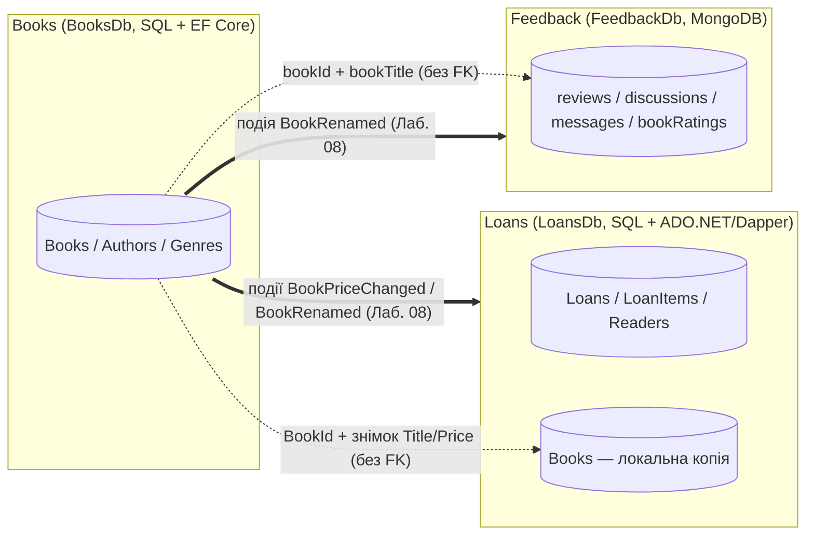

# Предметна область «Онлайн-бібліотека» та межі контекстів

## Опис домену

**Онлайн-бібліотека** — сервіс, через який **читачі** переглядають каталог книг, оформлюють
**видачу** (оренду) примірників із самовивозом або кур'єрською доставкою, оплачують плату за видачу
та повертають книги. **Бібліотекарі** ведуть каталог і обробляють видачі. Читачі також залишають
**відгуки** з оцінками й обговорюють книги в читацьких клубах. Мета системи — дати читачам зручний
доступ до фонду бібліотеки, а бібліотеці — контроль над примірниками та оплатами.

## Три незалежні контексти (Bounded Contexts)

Кожен контекст — окремий мікросервіс із **власною базою даних** і власною моделлю. Сутність належить
рівно одному контексту; інші контексти знають про неї лише за ідентифікатором (і, за потреби, зберігають
знімок чи копію окремих полів — див. [політику дублювання](duplication-policy.md)). Між базами немає
жодного `FOREIGN KEY` і жодного міжсервісного `JOIN`.

| # | Контекст (сервіс) | База / технологія | Власні сутності | Агрегати |
|---|---|---|---|---|
| 1 | **Loans** — видачі (`loans-api`) | `LoansDb`, SQL Server + ADO.NET & Dapper | `Reader`, `Loan`, `LoanDetails`, `LoanItem`, `LoanStatusHistory`, `Payment`, `Book` (локальна копія довідника; власне поле — `AvailableCopies`) | **Loan** = Loan + LoanDetails + LoanItems + LoanStatusHistory; **Reader**; **Payment** |
| 2 | **Books** — каталог книг (`books-api`) | `BooksDb`, SQL Server + EF Core (Code First) | `Book`, `BookDetail`, `BookImage`, `Author`, `Genre`, `BookGenre` | **Book** = Book + BookDetail + BookImages + BookGenres; **Author**; **Genre** (довідник) |
| 3 | **Feedback** — відгуки й обговорення (`feedback-api`) | `FeedbackDb`, MongoDB | `Review` (+ вбудовані `Comment`, value object `Author`), `Discussion`, `Message`, `BookRating` | **Review** (документ із коментарями); **Discussion** (заголовок + subset останніх повідомлень); **Message**; **BookRating** (обчислюваний) |

### Чому саме така технологія

* **Loans → SQL + ADO.NET/Dapper.** Видача — транзакційний процес зі строгими переходами статусів
  (оформлено → зарезервовано → оплачено → видано → повернуто), грошима та залишком примірників.
  Потрібні збережувані процедури, явні транзакції, блокування рядків і перевірка цілісності.
* **Books → SQL + EF Core.** Каталог має багато сутностей і всі типи зв'язків (1:1, 1:N, M:N із власним
  полем), довідники з фіксованими Id і схему, що розвиватиметься міграціями.
* **Feedback → MongoDB.** Відгуки мають змінну структуру (фото, прогрес читання, цитата — лише в
  частини), вкладені коментарі та необмежені обговорення — природна документна модель.

### Життєвий цикл агрегату «Видача»

```text
Submitted ──► AwaitingValidation ──► Reserved ──► Paid ──► Issued ──► Returned
    │                 │                  │
    └─────────────────┴──────────────────┴──► Cancelled   (скасування — лише до оплати)
```

* `Reserved` — бібліотека зарезервувала примірники (`Books.AvailableCopies` зменшено).
* Не можна видати (`Issued`) неоплачену видачу — процедура `usp_ChangeLoanStatus` повертає керовану помилку `50002`.
* Позиції (`LoanItems`) не існують без видачі й змінюються лише через неї (каскадне видалення).

### Взаємодія контекстів



* **Books → Loans:** Loans зберігає `BookId` і копію `Title`, `Isbn`, `Price` у таблиці `Books`
  (оновлюється подіями Каталогу), а в позиціях видачі — **знімок** `BookTitle`, `UnitPrice`.
* **Books → Feedback:** відгуки, обговорення й рейтинги зберігають `bookId` і денормалізований `bookTitle`.
* **Loans ↔ Feedback:** контексти не обмінюються даними (дубльованих полів немає); у картці видачі
  відгуки підтягує Aggregator (Лаб. 05) за `bookId`.
