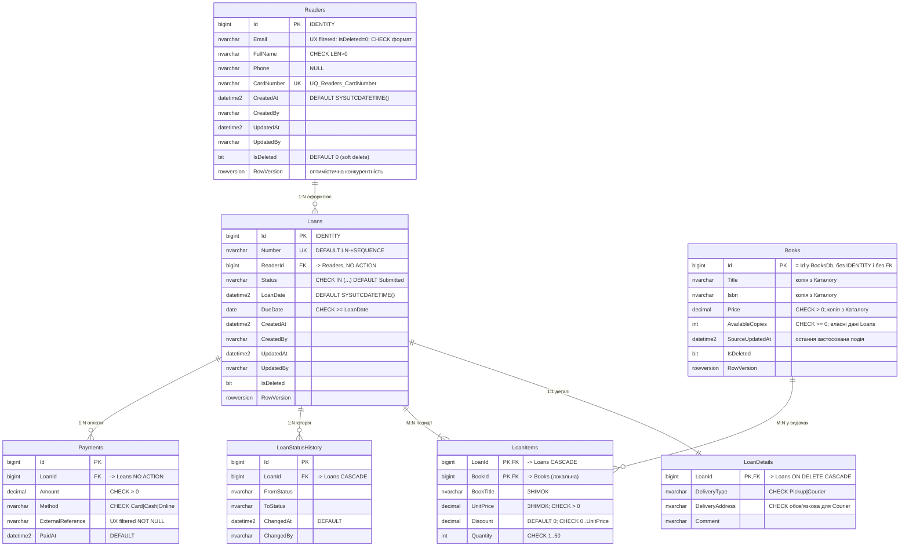

# ERD — Проєкт №1 `LoansDb` (SQL Server + ADO.NET & Dapper)

DDL: [`db/p1/schema.sql`](../db/p1/schema.sql) · процедури: [`db/p1/procedures.sql`](../db/p1/procedures.sql) ·
seed: [`db/p1/seed.sql`](../db/p1/seed.sql) · DBML для dbdiagram.io: [`erd-p1.dbml`](erd-p1.dbml)

## Типи зв'язків

| Тип | Таблиці | Де FK |
|---|---|---|
| **1:1** | `Loans` ↔ `LoanDetails` | `LoanDetails.LoanId` — водночас PK і FK |
| **1:N** | `Readers` → `Loans`; `Loans` → `Payments`; `Loans` → `LoanStatusHistory` | FK на боці «багатьох» |
| **M:N** | `Loans` ↔ `Books` через `LoanItems` | дві FK + складений PK `(LoanId, BookId)`; власні поля `BookTitle`, `UnitPrice`, `Discount`, `Quantity` |

Каскади свідомі: позиції, деталі та історія видаляються разом із видачею (`ON DELETE CASCADE`),
а читач з історією видач і платежі — ні (`NO ACTION`).

## Ключі

`BIGINT IDENTITY` — записи створює лише сервіс «Видачі», вставка послідовна з одного джерела, ключ
компактний і не фрагментує кластерний індекс. GUID доречний, коли ідентифікатори генеруються в різних
місцях (кілька сервісів, офлайн-клієнти) — тут цього немає. Виняток — `Books.Id`: це **не** власний ключ,
а той самий Id, що в `BooksDb` (без `IDENTITY`).

## Індекси (кожен — під конкретний запит)

| Індекс | Тип | Запит |
|---|---|---|
| `IX_Loans_ReaderId_Status` | фільтрований (`IsDeleted = 0`), покриваючий (`INCLUDE Number, DueDate`) | видачі читача з певним статусом, нові згори |
| `IX_Loans_Status_LoanDate` | фільтрований, покриваючий | черга бібліотекаря за статусом із пагінацією `OFFSET/FETCH` |
| `IX_Loans_Overdue` | фільтрований (`Status = 'Issued'`) | прострочені видачі (`DueDate < today`) |
| `IX_LoanItems_BookId` | покриваючий (`INCLUDE Quantity`) | у яких видачах книга / скільки примірників видано; підтримка FK |
| `IX_LoanStatusHistory_LoanId` | складений `(LoanId, ChangedAt)` | історія статусів видачі в хронологічному порядку |
| `IX_Payments_LoanId` | покриваючий | платежі видачі |
| `UX_Payments_ExternalReference` | унікальний фільтрований (`IS NOT NULL`) | ідемпотентність оплати за зовнішнім ідентифікатором |
| `UX_Readers_Email_Active` | унікальний фільтрований (`IsDeleted = 0`) | пошук активного читача за email; email видаленого можна використати повторно |
| `IX_Books_Title` | фільтрований, покриваючий | автодоповнення назви книги при оформленні |

## Аудит, м'яке видалення, конкурентність

* `CreatedAt/CreatedBy/UpdatedAt/UpdatedBy` — у `Readers`, `Books`, `Loans`; `IsDeleted` — м'яке видалення
  (фільтровані індекси містять лише «живі» записи).
* `RowVersion ROWVERSION` — у `Readers`, `Books`, `Loans`: видачу одночасно редагують бібліотекарі й читач
  (адреса доставки, статус). `usp_UpdateLoanDetails` приймає очікуваний `RowVersion` і повертає помилку
  `50003`, якщо запис уже змінено — замість «тихого» затирання. Для зміни статусу додатково використано
  песимістичне блокування `UPDLOCK, HOLDLOCK` всередині транзакції процедури.

## Збережувані процедури (6)

| Процедура | Операція | Транзакція / помилки |
|---|---|---|
| `usp_CreateLoan` | CREATE: видача + деталі + позиції (TVP `dbo.LoanItemList`) + історія; знімок назви/ціни | так; `50001` читач/книга не знайдені, `50004` порожній список |
| `usp_GetLoanById` | READ: два набори результатів (заголовок+деталі, позиції) | — |
| `usp_UpdateLoanDetails` | UPDATE деталей із перевіркою `RowVersion` | так; `50001`, `50002` (вже видано), `50003` конфлікт версій |
| `usp_ChangeLoanStatus` | **транзакційна зміна статусу** з таблицею допустимих переходів + запис в історію | так; `50002` недопустимий перехід (наприклад, `Reserved -> Issued`) |
| `usp_ConfirmLoan` | бізнес-операція «зарезервувати примірники» (`Submitted/AwaitingValidation -> Reserved`) | так; `50002` якщо видача не нова |
| `usp_RegisterPayment` | платіж + `Reserved -> Paid` в одній транзакції; ідемпотентна за `ExternalReference` | так; `50002`, `50004` сума не дорівнює вартості |

Представлення `dbo.vw_LoanSummary` — денормалізоване читання (видача + ім'я читача + кількість позицій + сума).
