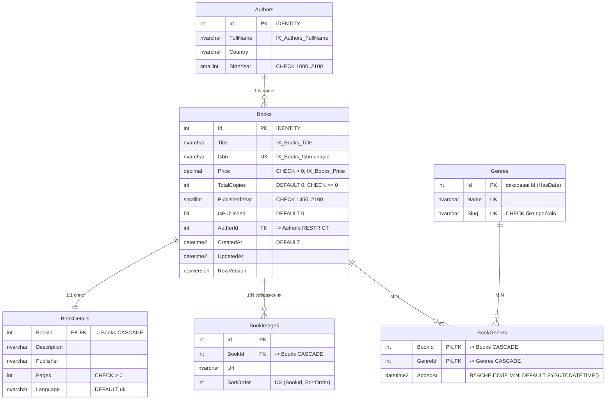

# ERD — Проєкт №2 `BooksDb` (SQL Server + EF Core Code First)

DDL: [`db/p2/schema.sql`](../db/p2/schema.sql) · seed: [`db/p2/seed.sql`](../db/p2/seed.sql) ·
DBML для dbdiagram.io: [`erd-p2.dbml`](erd-p2.dbml)

На етапі Лаб. 01 схема спроєктована й записана DDL-скриптом; у Лаб. 03 та сама модель описується
класами-сутностями + Fluent API (`IEntityTypeConfiguration<T>`), а база створюється **міграціями**
EF Core. Тому всі обмеження мають явні імена, а довідник `Genres` — фіксовані Id (статичний сідінг `HasData`).

## Сутності (6) і зв'язки

| Тип | Сутності | Реалізація |
|---|---|---|
| **1:1** | `Book` ↔ `BookDetail` | `BookDetails.BookId` — PK і FK (у EF: `HasOne().WithOne().HasForeignKey<BookDetail>()`) |
| **1:N** | `Author` → `Books`; `Book` → `BookImages` | FK на боці «багатьох» |
| **M:N** | `Book` ↔ `Genre` через `BookGenre` | проміжна сутність зі **складеним ключем** `(BookId, GenreId)` і **власним полем `AddedAt`** — автоматичне M:N EF Core цього поля не зберегло б |

## Ключі, обмеження, індекси

* PK `INT IDENTITY` — каталог є єдиним джерелом книг і авторів; `Genres.Id` задані вручну (довідник).
* `CHECK`: `Price > 0`, `TotalCopies >= 0`, роки в розумних межах, `Pages > 0`, `Slug` без пробілів.
* `UNIQUE`: `Isbn`, `Genres.Name`, `Genres.Slug`, `(BookId, SortOrder)`.
* `DEFAULT`: `TotalCopies = 0`, `IsPublished = 0`, `Language = 'uk'`, `AddedAt/CreatedAt = SYSUTCDATETIME()`.
* Індекси під запити: `IX_Books_Isbn` (перевірка дубліката ISBN → 409), `IX_Books_Title` (пошук/сортування
  за назвою), `IX_Books_Price` (фільтр діапазону цін), `IX_Books_AuthorId` (книги автора),
  `IX_BookGenres_GenreId_AddedAt` («нещодавно додані в жанр» — запит через власне поле M:N),
  `IX_BookImages_BookId_SortOrder` (галерея в порядку), `IX_Authors_FullName` (пошук автора).

## Початкові дані

* Довідник `Genres` (6 записів із фіксованими Id) — статичний сідінг.
* 8 авторів, 8 книг (Id 1..8 збігаються з локальною копією в `LoansDb`), деталі, зображення, 14 зв'язків книга–жанр.

## Готовність до міграцій

Схема не містить нічого, що EF Core не може описати Fluent API (ключі, складені ключі, `HasCheckConstraint`,
`HasDefaultValueSql`, унікальні індекси, `IsRowVersion`). Майбутні зміни (новий стовпець, індекс)
вноситимуться міграціями `dotnet ef migrations add ...` із збереженням історії в `__EFMigrationsHistory`.
